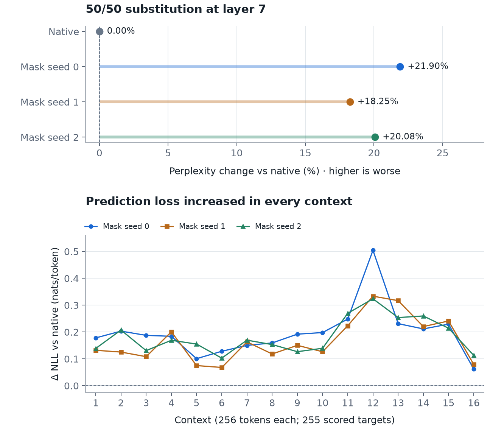

# Layer-7 50/50 routed contribution benchmark

## Protocol fixed before execution

Replace exactly four of the eight routed expert contributions for **every token
at OLMoE layer 7**, using three fixed random position masks. The other four
contributions remain native. This changes one layer, not half the whole model.

- Primary: `allenai/OLMoE-1B-7B-0924`, revision
  `6d84c48581ece794365f2b8e9cfb043c68ade9c5`.
- Donor: `ibm-granite/granite-3.1-1b-a400m-base`, revision
  `408b6e90baab8cf24f4aa9f8e19703ffa0a53b29`, layer 7 expert 0.
- Reuse the preceding benchmark's exact 4096 OLMoE token IDs, Tiny Shakespeare
  range `[16384, 20480)`. Sixteen consecutive 256-token contexts, reset between
  contexts; teacher-forced logits score the next 255 reference tokens per
  context, **4080 targets per condition**. No new text or selection by scores.
- Execute one native baseline, then masks with seeds **0, 1, 2**, once each.
  Independently for every token, draw `randperm(8)` and replace the first four
  positions of its native top-k list. Save all masks before loading models.
  Masks select routed positions, not a fixed set of expert identities.
- Keep the native router, its top-k indices, all original mixture weights, and
  the unmasked raw expert outputs. Replace each masked raw output before mixture
  weighting. The three masks vary only the positions receiving foreign outputs.
- Use the same existing frozen Granite expert for every selected position:
  truncate input 2048→1024 and zero-pad output 1024→2048. No additional scalar,
  norm matching, adapter training, or donor backbone. The donor response is
  evaluated once per token and reused in its four selected slots; this is not
  four distinct donor experts. Each copy receives its slot's native weight.
- Each split has **16,384 foreign and 16,384 native contributions**. Half by
  count need not mean half of routing weight or output magnitude. Record actual
  foreign routing-weight share. This implementation also computes overwritten
  native outputs for direct comparison; no compute-saving claim is made.
- CPU float32, deterministic algorithms, seed 0, 12 Torch threads, eager
  attention/experts, frozen weights, no KV cache. Accumulate float32 per-token
  cross-entropy in float64. Report mean NLL, perplexity, and paired per-context
  changes against native.
- During the native reference, compare the recorded eager expert sum with the
  original layer implementation. For each split verify unchanged layer-7
  inputs, router indices/weights, and unmasked raw outputs; record finite
  outputs and the MoE-output difference. Restore the original forward method
  afterward. No additional restoration inference is part of these three runs.

All results will be retained. These are three mask draws on one previously
evaluated literary slice, not independent datasets or a general capability
benchmark. There are no zero/random-weight controls at this density, so this
experiment alone cannot isolate a benefit from donor pretraining. No tuning,
additional seeds, or automatic expansion follows the results.

Run: `uv run python benchmark_half_split.py`.
The output directory must be new; `--output` can select a fresh destination.

## Results

**Execution PASS; prediction quality degraded on this slice.** All three split
runs completed once with finite outputs. The native reference and three split
runs total 64 context forwards and 4080 scored targets per condition. No training,
tuning, extra seeds, or reruns followed the results.

| Condition | Mean NLL (nats/token) | Perplexity | Δ NLL vs native | Perplexity change | Foreign routing-weight share |
|---|---:|---:|---:|---:|---:|
| Native | 0.742269302 | 2.100697226 | +0.000000000 | +0.0000% | 0.0000% |
| Mask seed 0 | 0.940273272 | 2.560681086 | +0.198003970 | +21.8967% | 50.1614% |
| Mask seed 1 | 0.909872693 | 2.484006282 | +0.167603391 | +18.2468% | 49.8731% |
| Mask seed 2 | 0.925219271 | 2.522421293 | +0.182949969 | +20.0754% | 50.0597% |

Perplexity increased by **18.25%–21.90%** across the three masks. Mean next-token
loss increased in **all 16 contexts for each mask**. This is a prediction-quality
degradation on the evaluated slice, even though the execution mechanism completed
correctly. These three masks vary substitution positions on the same reference
text; they do not constitute three independent datasets.

Each split replaced exactly **16,384 of 32,768 routed contributions**, touching
all 4096 input positions. Of those foreign contributions, 16,320 were at positions
with an immediately scored next-token target. The foreign share of routing weight
was 49.87%–50.16%. The single donor response for each input was reused across four
selected slots, with each original native mixture weight applied separately.

### Execution evidence

- All 48 intervened context forwards preserved layer-7 router indices, mixture
  weights, and pre-intervention expert inputs exactly.
- All retained native raw outputs matched the native reference exactly; every
  replaced raw output matched the projected pretrained Granite response exactly.
- The reconstructed native expert sum matched the original implementation
  exactly on all 16 baseline contexts. The baseline returned the original result.
- Every recorded raw output, MoE sum, logit tensor, and token loss was finite.
- Every intervened layer-7 MoE sum changed (context-level L2 difference range
  3.889601–4.684815). The changed next-token losses demonstrate downstream influence.
- Each split made 16 donor batch calls covering 4096 token inputs. Only the
  standalone pretrained Granite layer-7 expert 0 executed; its backbone did not.
- Saved losses reconcile exactly with aggregate NLLs; saved masks have exactly
  four selected positions per token. All 4080 native token losses also match the
  previous benchmark exactly.
- The original forward method was restored afterward. This benchmark did not
  perform an additional restoration inference.

The routing and retained-output equality claims concern the intervention boundary
at layer 7. Later layers may change their activations or routing as a consequence.

### Per-context loss changes

Values are condition NLL minus native NLL, in nats/token. Context labels below
are 1-based; machine receipts use 0-based indices.

| Context | Mask seed 0 | Mask seed 1 | Mask seed 2 |
|---:|---:|---:|---:|
| 1 | +0.178060 | +0.131885 | +0.138844 |
| 2 | +0.203310 | +0.125328 | +0.207301 |
| 3 | +0.187481 | +0.108149 | +0.130728 |
| 4 | +0.184010 | +0.200694 | +0.169161 |
| 5 | +0.100742 | +0.074953 | +0.155145 |
| 6 | +0.128239 | +0.067953 | +0.102690 |
| 7 | +0.150206 | +0.163133 | +0.169622 |
| 8 | +0.159289 | +0.118208 | +0.153207 |
| 9 | +0.192034 | +0.150348 | +0.126730 |
| 10 | +0.197978 | +0.126510 | +0.139385 |
| 11 | +0.248268 | +0.223386 | +0.269841 |
| 12 | +0.504537 | +0.333522 | +0.323747 |
| 13 | +0.231141 | +0.316853 | +0.253811 |
| 14 | +0.211571 | +0.220241 | +0.259782 |
| 15 | +0.229274 | +0.241127 | +0.214162 |
| 16 | +0.061922 | +0.079365 | +0.113041 |

### Interpretation and limits

The preceding expert-0-only benchmark showed no aggregate loss increase on this
slice. That observation does not extend to replacing half of the routed outputs
for every token in this layer. This follow-up changes both replacement density
and which native experts are affected; it is not a controlled density-response
curve or a located degradation threshold.

Cross-architecture execution remains possible at the tested load, while prediction
quality suffers. This result neither establishes a useful contribution from donor
pretraining nor rules one out: no matched zero or random-weight conditions were
run at the 50% density. The fixed projection, repeated use of a single donor, and
removal of diverse native contributions are all part of the tested condition.
Only one layer was modified, and the metric measures reference-token prediction
on this slice, not overall model capability or free-running generation quality.

### Artifacts

- [Executable](benchmark_half_split.py)
- [Protocol written before scoring](results/half-split-benchmark/protocol.json)
- [Numerical receipt](results/half-split-benchmark/receipt.json)
- [Three exact masks](results/half-split-benchmark/masks.pt)
- [Input token IDs](results/half-split-benchmark/input_ids.pt)
- [Per-token losses](results/half-split-benchmark/loss_per_token.pt)
- [Native routing indices and weights](results/half-split-benchmark/native_routing.pt)
- [Figure SVG](results/half-split-benchmark/comparison.svg), [PNG](results/half-split-benchmark/comparison.png), [HTML](results/half-split-benchmark/comparison.html)
