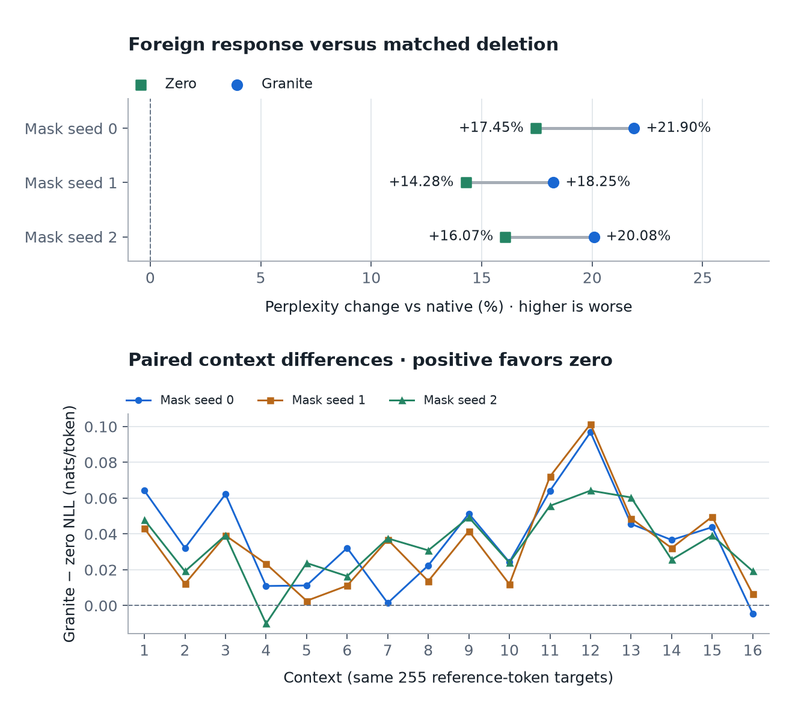

# Matched-zero diagnostic for the 50/50 layer-7 masks

## Fixed protocol

Run exactly three new conditions, setting the same four raw expert contributions
to zero for each token at OLMoE layer 7. Reuse the saved masks (seeds 0, 1, 2),
input IDs, and native routing from `results/half-split-benchmark/`. Do not draw new
masks or rerun the native and Granite conditions. Those recorded measurements
remain the references.

Primary: `allenai/OLMoE-1B-7B-0924`, revision
`6d84c48581ece794365f2b8e9cfb043c68ade9c5`. The existing foreign reference used
`ibm-granite/granite-3.1-1b-a400m-base`, revision
`408b6e90baab8cf24f4aa9f8e19703ffa0a53b29`, layer 7 expert 0. This zero diagnostic
loads and executes no donor.

Use the same 4096-token Tiny Shakespeare slice [16384, 20480), sixteen 256-token
contexts, context resets, and 4080 teacher-forced next-token targets. CPU float32,
12 threads, deterministic algorithms, seed 0, eager attention/experts, frozen
weights, no KV cache; accumulate float32 per-token loss in float64.

The native top-k indices and mixture weights remain unchanged. Do not
renormalize the four surviving contributions. Retain the native eager sum order.
Record exact zeroed-position counts, equality with saved routing, retained raw
outputs versus their computed native values, finiteness, and per-context losses.

Report mean NLL and perplexity relative to the saved native baseline. Pair each
zero run with the Granite run using the identical mask. Define the paired
difference as **Granite NLL minus zero NLL**: negative means Granite predicts the
reference tokens better than deletion; positive means worse. Even a benefit
over zero would not establish a benefit from pretraining. The three masks reuse
one slice, and no random-weight comparison at this density is included.

No tuning, new prompts, extra seeds, or subsequent optimization. Restore the
original forward method after scoring; do not claim an additional numerical
restoration run. Preserve all earlier receipts unchanged.

Run: `uv run python benchmark_half_zero.py`. The output directory must be new;
`--output` can choose a fresh destination.

## Results

**COMPLETED. All three zero controls were finite; Granite was worse than zero in aggregate for every mask.**

The saved native baseline has NLL 0.742269302 and perplexity 2.100697226.
Only the three zero conditions were newly executed (48 context forwards).
The recorded native and Granite conditions were reused without rerunning.

| Mask seed | Zero NLL | Zero perplexity | Granite perplexity | Granite − zero NLL | Granite perplexity vs zero |
|---:|---:|---:|---:|---:|---:|
| 0 | 0.903076391 | 2.467181463 | 2.560681086 | +0.037196881 | +3.7897% |
| 1 | 0.875733765 | 2.400636151 | 2.484006282 | +0.034138928 | +3.4728% |
| 2 | 0.891306867 | 2.438314123 | 2.522421293 | +0.033912404 | +3.4494% |

Zero replacement increased perplexity by 14.28%–17.45% versus native. The foreign
response increased it by a further 3.45%–3.79% **relative to the corresponding
zero condition**. These percentages have different denominators and are not
additive. The paired NLL difference directly compares Granite and zero.

Granite had higher context-mean loss than zero in 15/16, 16/16, and 15/16 contexts
for mask seeds 0, 1, and 2 respectively: 46/48 paired comparisons. The two
exceptions are retained below. These contexts and masks reuse the same text; no
confidence interval, generalization, or independent-replication claim is made.

Each new run zeroed exactly 16,384 routed contributions, retaining 16,384 native
contributions. Saved masks and token IDs were reused exactly. The router indices
and weights matched the saved native references exactly. Retained raw outputs
matched their computed native values, and all masked outputs were exactly zero.
These checks concern layer 7; downstream computation may change. No donor was
loaded or evaluated. The original forward method was restored afterward; no
additional numerical restoration forward was executed.

| Context | Granite − zero, seed 0 | Seed 1 | Seed 2 |
|---:|---:|---:|---:|
| 1 | +0.064194 | +0.043172 | +0.047897 |
| 2 | +0.032188 | +0.012184 | +0.019149 |
| 3 | +0.062269 | +0.039168 | +0.039250 |
| 4 | +0.010954 | +0.023345 | -0.010062 |
| 5 | +0.011244 | +0.002672 | +0.023781 |
| 6 | +0.032187 | +0.011138 | +0.016423 |
| 7 | +0.001434 | +0.036860 | +0.037561 |
| 8 | +0.022448 | +0.013678 | +0.030864 |
| 9 | +0.051342 | +0.041617 | +0.049261 |
| 10 | +0.024268 | +0.011941 | +0.023975 |
| 11 | +0.064115 | +0.072093 | +0.055734 |
| 12 | +0.096867 | +0.101416 | +0.064227 |
| 13 | +0.045617 | +0.048690 | +0.060422 |
| 14 | +0.036657 | +0.032151 | +0.025684 |
| 15 | +0.043809 | +0.049664 | +0.039166 |
| 16 | -0.004443 | +0.006432 | +0.019266 |

**Interpretation:** deleting these native contributions already harms prediction.
Adding the fixed projected Granite response at those same positions adds further
aggregate harm in all three tested masks. It does not recover prediction
performance relative to deletion in this configuration. This does not show that
foreign computation or pretrained experts are generally harmful: the expert,
projection, repeated response, magnitude, receiving layer, and text slice remain
specific to this experiment. No random-weight comparison at this density was run.
The execution-feasibility findings are unchanged. No optimization follows.

- [Executable](benchmark_half_zero.py)
- [Protocol](results/half-split-zero/protocol.json)
- [Numerical receipt](results/half-split-zero/receipt.json)
- [Token losses](results/half-split-zero/loss_per_token.pt)
- [Exact masks](results/half-split-zero/masks.pt) and [input IDs](results/half-split-zero/input_ids.pt)
- [Foreign/native reference receipt](results/half-split-benchmark/receipt.json)
- [Figure SVG](results/half-split-zero/comparison.svg), [PNG](results/half-split-zero/comparison.png), [HTML](results/half-split-zero/comparison.html)
