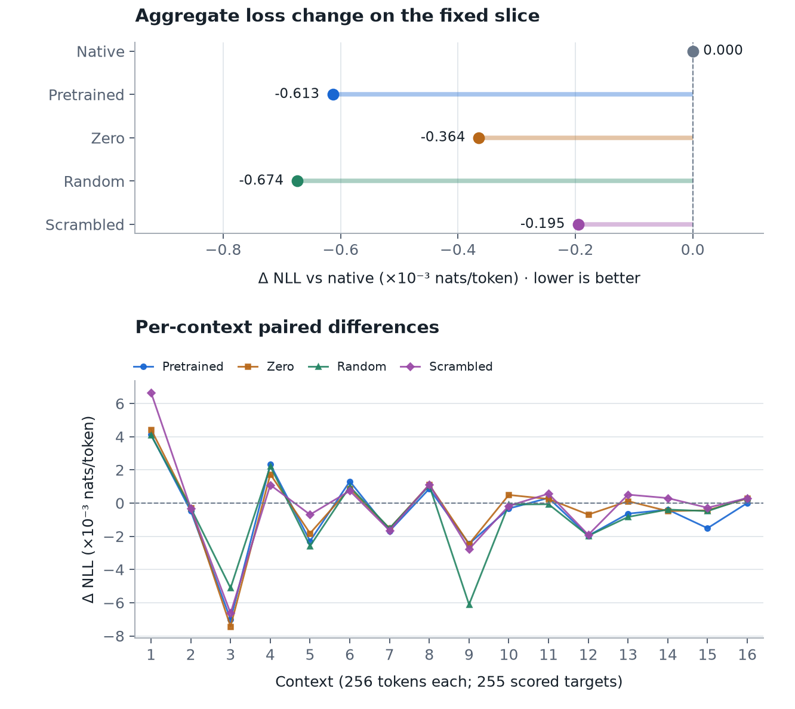

# Fixed OLMoE/Granite substitution benchmark

## Protocol fixed before execution

Measure the change in reference-text next-token prediction when replacing
OLMoE layer-7 expert 0. This is a bounded descriptive evaluation, separate from
the completed feasibility experiments and from any optimization campaign.

- Primary: `allenai/OLMoE-1B-7B-0924`, revision
  `6d84c48581ece794365f2b8e9cfb043c68ade9c5`.
- Donor: `ibm-granite/granite-3.1-1b-a400m-base`, revision
  `408b6e90baab8cf24f4aa9f8e19703ffa0a53b29`, layer 7 expert 0.
- Data: the existing pinned Tiny Shakespeare corpus, OLMoE-token range
  `[16384, 20480)`. This fixed 4096-token slice is outside the previous Co-MoE
  training `[0, 8192)` and evaluation `[336144, 340240)` ranges. It was selected
  before observing its losses or routing, not for favorable scores or activation
  coverage. No claim is made that it was absent from model pretraining.
- Sixteen consecutive 256-token contexts, with context/KV reset at each boundary.
  Teacher forcing uses the same reference text in all conditions. Position j's
  logits score reference token j+1: 255 targets per context, **4080 total**.
  Cross-context transitions are not scored. This is explicitly a short-context
  slice evaluation, not standard full-corpus perplexity.
- Five conditions, executed once in order: native, pretrained Granite, zero,
  random Granite, scrambled Granite. No new training or hyperparameter selection.
- Replace only the selected native expert's raw output under its original router
  indices and mixture weights. Truncate input 2048→1024; zero-pad output
  1024→2048. No extra scalar coefficient or learned adapters.
- Random uses independent Gaussian weights, standard deviation 0.02, seed 1.
  Scrambled uses independent scalar permutations within the original gate, up,
  and down matrices, seed 2. Each random/scrambled projected response is matched
  to the pretrained response's L2 norm on that same native expert input, before
  mixture weighting. These controls retain a pretrained input-dependent norm;
  their directions are altered. Relative norm tolerance: 1e-5.
- Runtime: CPU float32, deterministic algorithms, seed 0, 12 Torch threads,
  eager attention and experts, frozen model weights. No donor backbone executes.
- Metrics: mean next-token negative log-likelihood in nats; perplexity =
  exp(mean NLL); paired NLL differences per context; total selected rows and the
  subset whose logits have a scored next-token target. Float32 per-token loss
  values are accumulated in float64.

Every condition is retained regardless of score. A quality decline does not
invalidate the previous feasibility results. This single literary slice and
single random/scrambled draw do not support broad quality or statistical
superiority claims. No speed comparison is intended.

Run from this repository: `uv run python benchmark_substitution.py`.
The output directory must be new; use `--output` to choose a fresh location.
Existing historical receipts and the manuscript remain unchanged.

## Results

**COMPLETED — all five conditions, one run each; no tuning or reruns.**

Each condition scored the same 4080 targets. The native router selected layer-7
expert 0 for 144 of the 4096 input rows (3.52%), distributed across all 16 contexts.
Of those, 143 rows had an immediately scored next-token target. Later predictions
can also depend on an earlier replacement, so this is not a count of affected losses.

| Condition | Mean NLL (nats/token) | Perplexity | Δ NLL vs native | Perplexity change |
|---|---:|---:|---:|---:|
| Native | 0.742269302 | 2.100697226 | +0.000000000 | +0.0000% |
| Pretrained | 0.741656358 | 2.099410010 | -0.000612945 | -0.0613% |
| Zero | 0.741904849 | 2.099931760 | -0.000364453 | -0.0364% |
| Random | 0.741595416 | 2.099282072 | -0.000673886 | -0.0674% |
| Scrambled | 0.742074709 | 2.100288485 | -0.000194593 | -0.0195% |

Lower NLL and perplexity mean better prediction of these reference tokens. All
four substitutions slightly reduced aggregate loss on this particular slice.
Pretrained Granite reduced perplexity by 0.0613%, but the random control had a
slightly lower loss, and removing the native expert also slightly reduced loss.
The pretrained-minus-random difference was +0.000060942 nats/token; the
pretrained-minus-zero difference was −0.000248491 nats/token. These small, mixed
control comparisons do not establish a benefit from pretrained donor structure.

All 80 context forwards completed with finite recorded outputs, logits, and
losses. Across the 64 intervened forwards, the selected layer retained exactly
the native routing indices, mixture weights, and selected expert inputs. MoE
output rows that did not select expert 0 also matched exactly (max absolute
error 0). This check concerns layer 7; downstream routing may change as a result
of the intervention. Each nonzero condition executed its donor once per context.
Random and scrambled conditions also evaluated the pretrained donor once per
context to obtain the norm reference. Maximum relative norm error was
2.18323308e-07, below the fixed 1e-5 tolerance.

The original forward method was restored and hooks removed after scoring. This
benchmark did not add a sixth restoration inference; it does not claim a new
numerical restoration measurement. Historical feasibility receipts remain intact.

### Per-context evidence

Each cell below is condition NLL minus native NLL, in nats/token. Context numbers
are 1-based here; the machine receipt uses 0-based indices. Signs vary across
contexts, and the 16 adjacent literary contexts are not independent replications.

| Context | Expert-0 rows | Pretrained | Zero | Random | Scrambled |
|---:|---:|---:|---:|---:|---:|
| 1 | 13 | +0.004116 | +0.004439 | +0.004083 | +0.006659 |
| 2 | 5 | -0.000480 | -0.000283 | -0.000291 | -0.000310 |
| 3 | 6 | -0.007007 | -0.007428 | -0.005115 | -0.006627 |
| 4 | 10 | +0.002331 | +0.001742 | +0.002219 | +0.001093 |
| 5 | 20 | -0.002286 | -0.001821 | -0.002586 | -0.000694 |
| 6 | 11 | +0.001310 | +0.000880 | +0.000991 | +0.000739 |
| 7 | 8 | -0.001681 | -0.001524 | -0.001525 | -0.001647 |
| 8 | 8 | +0.000862 | +0.001104 | +0.001057 | +0.001123 |
| 9 | 12 | -0.002456 | -0.002464 | -0.006107 | -0.002772 |
| 10 | 16 | -0.000328 | +0.000491 | -0.000086 | -0.000166 |
| 11 | 7 | +0.000310 | +0.000250 | -0.000066 | +0.000567 |
| 12 | 3 | -0.001963 | -0.000692 | -0.001969 | -0.001911 |
| 13 | 8 | -0.000636 | +0.000116 | -0.000835 | +0.000510 |
| 14 | 10 | -0.000394 | -0.000481 | -0.000389 | +0.000301 |
| 15 | 3 | -0.001512 | -0.000436 | -0.000482 | -0.000280 |
| 16 | 4 | +0.000006 | +0.000276 | +0.000318 | +0.000303 |

This is descriptive evidence from one fixed text slice and one draw of each
weight control, not evidence of general quality improvement, equivalence, or
statistical superiority. Norm matching carries the pretrained response magnitude
into the random/scrambled conditions: their comparisons isolate altered response
directions at matched magnitudes, not the complete absence of pretrained influence.
No further prompts, seeds, training, or optimization were introduced after viewing
the scores. The benchmark does not change the earlier feasibility conclusions.

### Artifacts

- [Executable experiment](benchmark_substitution.py)
- [Protocol written before scoring](results/substitution-benchmark/protocol.json)
- [Complete numerical receipt](results/substitution-benchmark/receipt.json)
- [Per-token losses](results/substitution-benchmark/loss_per_token.pt)
- [Exact input token IDs](results/substitution-benchmark/input_ids.pt) and [decoded slice](results/substitution-benchmark/slice.txt)
- [Native routing indices and weights](results/substitution-benchmark/native_routing.pt)
- [Figure: SVG](results/substitution-benchmark/comparison.svg), [PNG](results/substitution-benchmark/comparison.png), [inline HTML](results/substitution-benchmark/comparison.html)
