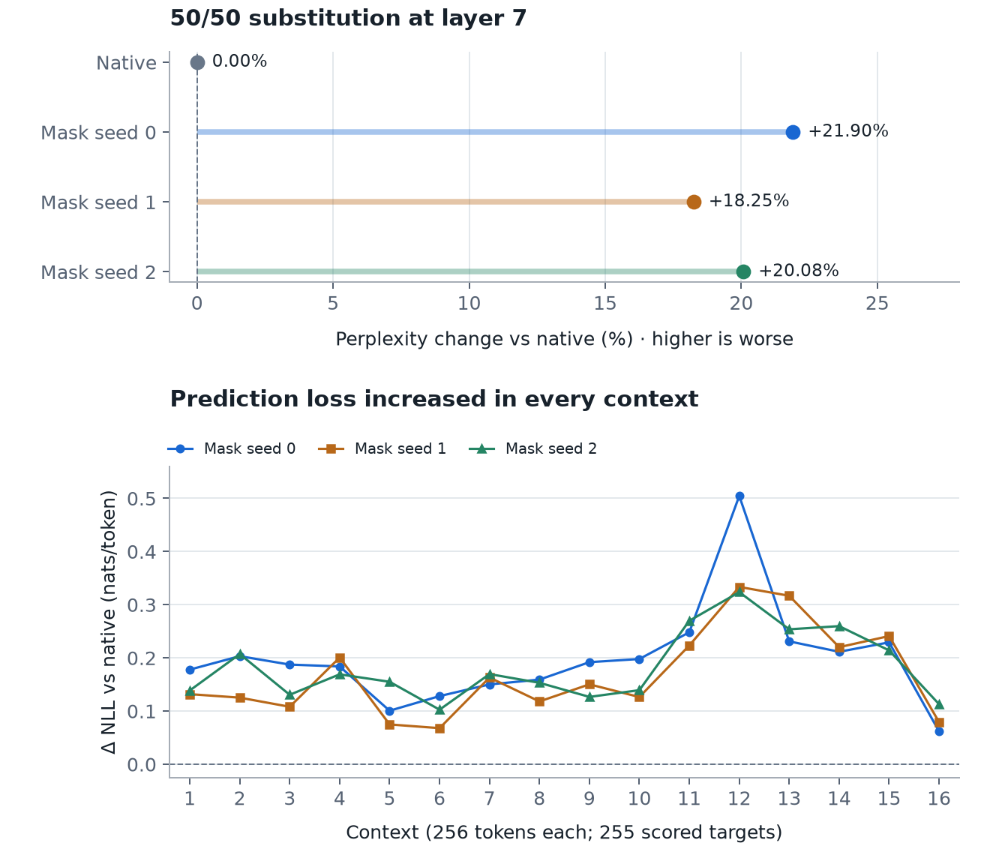

# Co-MoE: Causal Computational Coupling Between Independently Pretrained Mixture-of-Experts Models

**Ztripez von Matérn**

*Technical report · First draft · 10 November 2026*

## Abstract

Can an expert from one independently pretrained language model participate in another model's inference without retraining either backbone? We report a bounded execution study using OLMoE and Granite, two sparse mixture-of-experts models with different hidden widths and model configurations. Fixed truncation and zero-padding connect their pretrained experts. Four experiments demonstrate additive foreign-expert injection, replacement of a native expert's raw output under unchanged native routing, reciprocal expert-response exchange between two live inference streams, and one causally ordered A→B→A round trip. Donor-input and message-suppression interventions change recorded downstream activations and logits; disabling the mechanisms exactly restores the recorded native baselines under the tested runtime. All four arrangements complete generation with finite recorded tensors and logits. A subsequent teacher-forced evaluation replaces four of eight routed contributions at layer 7 for every input token with weighted copies of one frozen Granite response. All three fixed position masks complete with finite outputs, while perplexity increases by 18.25-21.90% on the same 4080 reference-token targets. Zeroing the identical positions is less damaging: Granite perplexity is 3.45-3.79% higher than its matched-zero control for every mask. This extends execution feasibility without establishing preserved prediction quality or recovery relative to deletion. A separate OLMoE/DeepSeek imitation experiment finds no observed advantage for pretrained donor weights over random or scrambled controls, and a parameter-matched bypass attains lower held-out error. These results establish specific executable forms of cross-model coupling, not semantic alignment, functional equivalence, or beneficial cooperation.

## 1. Question and scope

An MoE expert is usually evaluated inside the network that trained it. Its weights, expected activation distribution, routing policy, and surrounding residual computation are jointly shaped by that training. Co-MoE asks whether the execution boundary can be crossed while preserving the pretrained parameters and continuing the receiving model's inference.

Dimensional maps make composition mathematically straightforward. The empirical question here is narrower than discovering that neural functions can be composed: can concrete pretrained MoE implementations be connected at their internal execution boundaries, with direct evidence that the intended computation occurred and affected subsequent inference? A completed forward pass alone is insufficient. An inactive hook, an unselected expert, or an injected constant could otherwise give misleading evidence.

We separate four execution arrangements (Table 1). The first two use a standalone donor expert; the latter two retain both complete model backbones and their independent tokenization and generation state. The consistent demonstration pair is OLMoE/Granite. Historical DeepSeek experiments are reported separately and are not used to fill gaps in that four-part demonstration. Section 8 extends routed substitution to denser coverage in one layer and measures the resulting prediction loss. Measurement records the outcome; no tuning follows it.

| Arrangement | Operational claim tested |
| --- | --- |
| Injection | A pretrained foreign expert processes a receiving activation and its projected output enters the receiving residual. |
| Routed substitution | A foreign expert occupies one native expert's raw-output slot when the unchanged native router selects it. |
| Reciprocity | Two live model streams each send expert computation that causally influences the other stream. |
| Feedback | A first message influences a later return message, which then influences the originating stream. |

*Table 1. The feasibility ladder. These definitions concern execution and causal dependence. They do not require improved text or accurate imitation of the displaced expert.*

The contribution is an executable case study with intervention and restoration evidence across these arrangements. The feasibility runs use no learned bridge, joint training, shared tokenizer, or distributed infrastructure. We make no priority claim for activation-level model composition and no claim that the demonstrated coupling transfers useful expertise.

## 2. Relationship to prior work

**Model stitching.** Bansal, Nakkiran, and Barak [1] connect the lower layers of one frozen network to the upper layers of another through a learned stitching layer, evaluating the resulting task performance. That work establishes a direct precedent for connecting independently learned representations. Co-MoE instead retains a receiving backbone and inserts or substitutes an isolated expert; the central evidence here is execution and controlled downstream dependence.

**Frozen language-model composition.** CALM [2] combines frozen language models using learned linear projections and cross-attention between their layer representations. It evaluates useful task composition. Thus internal communication between frozen language models is already an established research direction. Our fixed-map experiments isolate a more limited feasibility question and do not reproduce CALM's capability claims.

**Expert assembly.** Branch-Train-MiX [3] branches a seed model, trains domain experts, assembles their feedforward parameters as MoE experts, averages other parameters, and then learns routing through MoE fine-tuning. Co-MoE uses checkpoints from different model families and leaves the receiving router unchanged in the substitution condition. It does not construct and train a merged backbone.

**Latent communication and message dependence.** XKV [4] learns a translator between the KV caches of frozen heterogeneous models with private contexts. Draft-KV [5] examines whether apparent communication gains depend on the supplied message, using reassigned-message controls, and trains a gated interface over draft KV states. These studies reinforce the distinction between adding an interface and demonstrating dependence on communicated content. Co-MoE's input negation and directional cuts test numerical causal dependence of expert responses. They do not establish semantic content transfer, which is a stronger criterion.

## 3. Models and experimental conventions

Model A is `allenai/OLMoE-1B-7B-0924` [6]. Model B is `ibm-granite/granite-3.1-1b-a400m-base` [7]. Both checkpoints were pretrained independently; neither is fine-tuned here. Exact revisions are given in Appendix A. All layer and expert indices are zero-based. Unless otherwise specified, layer 7, expert 0 is the selected expert in each model. The dense substitution in Section 8.2 replaces routed positions across A's layer-7 expert pool while retaining B's single expert 0 as donor.

| Property | OLMoE (A) | Granite (B) |
| --- | --- | --- |
| Residual width | 2048 | 1024 |
| Expert intermediate width | 1024 | 512 |
| Decoder layers | 16 | 24 |
| Experts per MoE layer / selected per token | 64 / 8 | 32 / 8 |
| Query heads / KV heads | 16 / 16 | 16 / 8 |
| Expert operator | SwiGLU | SwiGLU |

*Table 2. Checkpoint configuration differences. Heterogeneity includes width, depth, attention configuration, expert count, and implementation. Both selected experts share the same SwiGLU operator family.*

The feasibility runs use CPU float32, evaluation mode, deterministic PyTorch algorithms, seed 0, and eager attention and expert implementations. The recorded software is Python 3.13.7, PyTorch 2.15.0+cu132, and Transformers 5.22.2. Injection, controls, substitution, and the Section 8 benchmarks use 12 Torch threads; paired-stream experiments use six. All experiments run on one machine. Pretrained weights remain frozen; no learning occurs in Sections 4-6 or Section 8.

We measure L2 differences of specified activation snapshots and the final-layer logits at the last prompt position. Each comparison uses the same input and runtime. These are numerical intervention readouts, not quality metrics. Different rows may concern different tensor sizes; their magnitudes must not be compared as effect strengths across experiments or models. Raw logit L2 also depends on logit scale and common offsets and does not quantify a change in semantic meaning.

## 4. Foreign execution in one receiving model

### 4.1 Additive injection

Let P_AB retain the first 1024 coordinates of an OLMoE vector, and let P_BA append 1024 zeros to a Granite vector. For each token's native layer-7 residual output h_A, the injected state is

$$
h'_A = h_A + \alpha P_{BA} E_B(P_{AB}h_A), \qquad \alpha = 0.01.
$$

The standalone Granite layer-7 expert 0 executes with genuine checkpoint weights and its native SwiGLU operations. Its input is a projected residual, not an assertion that this residual matches Granite's training distribution. Checkpoint slices provide the expert's two logical input projections and output projection; no Granite attention, router, tokenizer, or backbone is instantiated or executed for these runs.

The prompt is “The capital of France is” (five OLMoE tokens), followed by four greedy tokens. Injection applies at every current token position during prefill and each subsequent decode call. The evidence compares the last prompt token at layer 8 and the corresponding final logits. Conditions are native baseline, pretrained injection, negated donor input, and bridge disabled again. Negation changes only the donor input, leaving the receiving prefix and bridge coefficient fixed.

### 4.2 Donor-weight controls

The same prompt, maps, and coefficient are used with three donor copies: pretrained, Gaussian random weights with standard deviation 0.02 and seed 1, and independently permuted scalar weights within each original gate/up/down matrix using seed 2. Scrambling preserves each matrix's empirical weight-value distribution while disrupting its arrangement. These are fixed controls, with no seed or distribution sweep.

For each current input, random and scrambled projected responses are rescaled to the pretrained projected response's L2 norm before applying α. The pretrained condition is reused from injection, because matching it to itself gives a scale of one. At the shared prefill input, this controls response norm across conditions. It does not match directions or input sensitivity. During decoding, each condition's reference norm is computed on its own current activation.

### 4.3 Native-routed substitution

For normalized native expert input x, let S(x) be OLMoE's selected expert indices and w_i(x) its existing mixture weights. The native expert sum and replacement are

$$
M_A(x)=\sum_{i\in S(x)} w_i(x)E_{A,i}(x),
$$

$$
M'_A(x)=M_A(x)+\mathbf{1}_{0\in S(x)}w_0(x)\left[P_{BA}E_B(P_{AB}x)-E_{A,0}(x)\right].
$$

Only expert 0's raw output changes. The replacement uses fixed truncation and padding, with no adapter, norm matching, or additional 0.01 coefficient. The native routing indices and weights are passed unchanged into the expert aggregation. Other selected experts retain their native operations and weights. The equation describes the intended sum; the implementation follows the eager native accumulation order to avoid introducing a different numerical kernel as a confound.

A previously recorded 256-token Tiny Shakespeare context [9], corpus token range [336144, 336400), exercises this expert and is followed by eight greedy tokens. It was reused for routing coverage, not selected to improve quality. The native router selects expert 0 at prompt positions 58, 70, 80, 147, 148, and 237; no generated-token position selects it in this run. Conditions are native, foreign replacement, zero raw output, and native restoration. The zero condition retains the original mixture weight and all other selected experts.

## 5. Injection and substitution results

| Comparison | Downstream activation Δ L2 | Last-prompt logits Δ L2 |
| --- | --- | --- |
| Injection: pretrained vs native | 0.00120284 | 1.07065 |
| Injection: negated input vs pretrained | 0.000844016 | 0.736441 |
| Substitution: foreign vs native | 0.135774 | 0.442968 |
| Substitution: zero vs native | 0.130443 | 0.452920 |
| Substitution: foreign vs zero | Not tabulated | 0.0998884 |

*Table 3. Granite injection and substitution. Injection reads layer 8 at the last prompt token; substitution reads layer 8 across the six selected prompt positions. All logits are from the last prompt position. Readout dimensions and prompts differ across arrangements.*

Input negation changes the recorded Granite expert output by L2 = 9.44771 × 10⁻⁶, as well as changing the downstream state and logits (Table 3). This attributes the receiving effect to the donor computation in the tested path, beyond merely observing that an injection exists. It does not show that pretraining is necessary for that effect.

| Donor condition | Projected response norm | Layer-8 Δ vs native | Logits Δ vs native |
| --- | --- | --- | --- |
| Pretrained | 0.000755439920 | 0.00120284 | 1.07065 |
| Random | 0.000755439978 | 0.00134458 | 1.24704 |
| Scrambled | 0.000755439862 | 0.00127603 | 1.07288 |

*Table 4. Norm-matched Granite controls at the last prompt position, before the 0.01 coefficient. Deltas are L2. Larger or smaller deltas are not interpreted as better behavior.*

The maximum per-token relative norm-matching error is 2.35 × 10⁻⁷, below the recorded tolerance of 10⁻⁵. Pre-injection prompt states are exactly equal. Random and scrambled contribution directions have cosine similarities of 0.0222 and 0.00577 to the pretrained direction. Their logits differ from the pretrained condition by L2 = 1.47746 and 1.61610, respectively. The controls produce distinct numerical responses at matched norms. No quality ranking or pretrained advantage follows from these observations.

The foreign substitution executes once on a batch of six selected prompt activations. The routing indices are identical to the native run and the routing-weight maximum absolute difference is zero. MoE output rows that do not select expert 0 are exactly unchanged. At selected rows, the measured sum difference agrees with the raw expert-output difference multiplied by the original mixture weight to within 3.58 × 10⁻⁹ maximum absolute error. The foreign-versus-zero comparison shows that the foreign slot contributes a measurable signal beyond removal of the native expert.

All ten distinct receiving-model generations in this replication complete with finite recorded tensors and logits: four injection conditions, two additional weight controls, and four substitution conditions. The pretrained control reuses an injection run. Each bridge-disabled restoration has zero maximum absolute error in its recorded downstream tensor and logits, with identical generated token IDs. Injection and weight controls produce the same four-token completion, ` Paris.\n\n`. Substitution conditions produce `\nUpon this island as a spy,`. These short, unchanged completions are observations of successful continuation, not evidence of maintained general quality.

The artifact classifies injection (R0), weight controls (R1), and routed substitution (R2) as PASS. For R1, PASS means that the specified control procedure completed with matched norms. It does not mean that pretrained weights outperformed the controls. For R2, PASS establishes execution-slot substitution, not functional equivalence to the native expert.

## 6. Two live inference streams

### 6.1 Reciprocal exchange

Both complete backbones remain resident. Two local threads maintain separate prompts, tokenizers, KV caches, and generated-token histories, and synchronize at explicit barriers. A uses “The capital of France is”; B uses “The largest planet is” (four Granite tokens). Each stream generates four greedy tokens.

During prefill, each model captures its normalized layer-7 MoE input at its own last prompt position. It evaluates its own layer-7 expert 0 with unit expert weight, independently of whether the native router selected that expert. Once both responses are ready, A's response is truncated and added to B's layer-7 residual output, and B's response is zero-padded and added to A's layer-7 residual output. Both additions use α = 0.01. Neither stream resumes past the boundary until its received message is available. No exchange occurs on later decode calls.

This experiment exchanges expert responses to each model's **own** live input. It does not ask the donor expert to process the receiving model's activation; that is established separately by injection and substitution. Corresponding layer numbers and last prompt positions are synchronization choices, not claims of semantic or token alignment.

The five paired conditions are native, reciprocal, A's outgoing message suppressed, B's outgoing message suppressed, and native restored. A directional cut sets the delivered response to zero while retaining the other direction. Both outgoing responses are computed from unchanged prefixes before either message is injected. This isolates each direction without feedback in the same exchange.

| Receiver | Coupled vs native: layer-8 Δ L2 | Coupled vs native: logits Δ L2 | Outgoing-only cut: own logits max error |
| --- | --- | --- | --- |
| OLMoE (A) | 0.0330057 | 3.51766 | 0 |
| Granite (B) | 0.0107525 | 0.492670 | 0 |

*Table 5. Reciprocal results. Cutting a receiver's incoming message changes its readouts relative to the coupled condition by the same deltas shown. Cutting only its outgoing message leaves its own recorded downstream state and logits exactly unchanged.*

All ten generations complete with finite recorded tensors and logits. Both models' pre-exchange expert inputs match their native counterparts exactly. Restoring native execution yields zero maximum absolute error in recorded downstream states and logits, and identical generated token IDs. A continues with ` Paris.\n\n`; B continues with ` Jupiter, which` in every condition. These observations demonstrate two directional effects within one paired execution, rather than two unrelated substitution runs.

### 6.2 One ordered round trip

Feedback uses the same model pair, prompts, coefficient, maps, and two layer-7 experts. In the first exchange, only A sends a response, which enters B's layer-7 residual output. A receives nothing and continues along its native path. B continues through subsequent computation; its normalized layer-9 MoE input therefore depends on the first message. B evaluates its **same layer-7 expert 0** on that later input and sends the response back to A. The return is injected into A's layer-9 residual output. Figure 1 shows the causal order.


The comparison is full exchange versus suppression of the first delivered message. Both runs still compute A's initial response and B's return response. The cut condition therefore does not reduce to a native A baseline: A still receives a freshly computed B response. A separate bridge-disabled condition tests native restoration.

The recorded order is A's first response ready, B's first injection, B's return response ready, then A's return injection. A's first computed response and its pre-return layer-9 residual are exactly equal between full and cut runs. B's later input, B's return response, and A's state after return all change (Table 6). Consequently, the difference at A is isolated to the path through B, rather than an earlier direct intervention on A's state.

| Full round trip vs first-message cut | Difference |
| --- | --- |
| A's first computed response, max absolute | 0 |
| A's residual immediately before return, max absolute | 0 |
| B's later normalized expert input, L2 | 0.471614 |
| B's return response, L2 | 0.0296149 |
| A's residual immediately after return, L2 | 0.000296150 |
| A's layer-10 residual, L2 | 0.000319656 |
| A's last-prompt logits, L2 | 0.0270037 |

*Table 6. Feedback intervention evidence. Zero-padding preserves the return-message difference norm; the 0.01 coefficient reduces it at injection, up to floating-point rounding.*

All eight generations across four paired conditions complete with finite recorded tensors and logits. Native restoration is exact at both models' recorded layer-10 states and logits, with identical generated token IDs. Short completions remain unchanged. This demonstrates one ordered return influence through a second model. The computation is an unrolled directed acyclic graph across different depths, not a recurrent fixed-point system; sustained interaction, convergence, and feedback stability are untested.

## 7. Separate exploratory result: native-expert imitation

The historical imitation study uses OLMoE layer-7 expert 0 as the frozen target and `deepseek-ai/DeepSeek-V2-Lite` layer-1 expert 0 as the frozen donor [8]. It is a different model pair from Sections 4–6. Both experts have input/output width 2048 and use SwiGLU; their intermediate widths are 1024 and 1408. The donor's 8,650,752 parameters stay frozen. No DeepSeek backbone executes.

The targets are actual native expert input/output pairs x → E_A,0(x), before mixture weighting. Only inputs selected by the native router are captured. Tiny Shakespeare's first 8192 OLMoE tokens yield 399 training pairs; its last 4096 tokens yield 262 held-out pairs, with a large unused intervening region. Native context resets every 256 tokens. The split separates corpus regions, but does not establish lexical novelty or exclude overlap with model pretraining data.

Only input and output maps learn. Each is a diagonal plus a rank-16 linear update without bias; the input map starts at identity and the output map at zero. With fixed training-only RMS constants s_y and s_E, prediction in native output units is

$$
\widehat{y}=s_y B_\theta\left(E_D(A_\theta(x))/s_E\right).
$$

The bypass is a bias-free 2048→33→SiLU→2048 network with zero output initialization. Each condition has exactly 135,168 trainable parameters. Pretrained, random, and scrambled donor paths use the same architecture and control recipes described earlier. Each receives 300 Adam updates, learning rate 0.001, batch size 64, initialization seed 3, and identical minibatch draws with seed 4. Fitting uses float32 CUDA with deterministic algorithms and TF32 disabled. The fixed final checkpoint is reported; held-out measurements at steps 0, 100, and 300 do not select the checkpoint.

| Condition | Held-out MSE | Relative MSE | Mean cosine |
| --- | --- | --- | --- |
| Pretrained donor | 0.00111955 | 0.910550 | 0.291698 |
| Bypass | 0.00106769 | 0.868368 | 0.345195 |
| Random donor | 0.00111290 | 0.905134 | 0.289369 |
| Scrambled donor | 0.00112140 | 0.912053 | 0.282653 |

*Table 7. Final-step results on 262 held-out pairs for the separate OLMoE/DeepSeek study. MSE averages over pairs and coordinates; relative MSE divides by zero-prediction MSE (0.00122954). Cosine is averaged per pair.*

The pretrained path reduces squared error by about 9% relative to predicting zero. The training-mean predictor has MSE 0.00118225 and mean cosine 0.202593. The bypass has 4.63% lower held-out MSE than the pretrained path and higher cosine. The random donor has slightly lower MSE than the pretrained donor, but the single run does not support a statistical comparison or equivalence claim. Parameter matching also does not equalize expressivity or optimization difficulty.

Foreign-path held-out MSE worsens slightly from step 100 to step 300 while training MSE decreases. No earlier checkpoint is substituted into the result. The study supplies no observed advantage for pretrained donor structure at this budget, and no parameter- or sample-efficiency evidence. It does not establish that useful transfer is impossible, nor does the modest fit establish native functional equivalence.


## 8. Prediction loss and denser routed substitution

### 8.1 Fixed-slice expert-0 evaluation

A bounded follow-up measures prediction loss under the same fixed OLMoE/Granite maps and raw-output substitution boundary. It uses Tiny Shakespeare token range [16384, 20480), outside the imitation study's training and evaluation ranges. This 4096-token slice was chosen before observing its losses or routing. Sixteen consecutive 256-token contexts are evaluated with teacher forcing and context reset. Each position's logits score the next reference token, yielding 255 targets per context and 4080 per condition. Mean negative log-likelihood (NLL) is measured in nats per token; perplexity is its exponential. Float32 token losses are accumulated in float64. This is a short-context slice evaluation, not standard full-corpus perplexity or evidence that the text was absent from pretraining.

Native, pretrained, zero, random, and scrambled conditions each run once. The native router selects layer-7 expert 0 at 144 input positions across all 16 contexts. Random and scrambled responses use the fixed weight-control recipes from Section 4.2, and their projected norms are matched to the pretrained response on the same input before mixture weighting. These controls retain the pretrained response's input-dependent magnitude while changing its direction; they are not wholly independent of pretrained computation.

| Expert-0 condition | Mean NLL | Perplexity | Perplexity change |
| --- | --- | --- | --- |
| Native | 0.742269 | 2.100697 | Reference |
| Pretrained Granite | 0.741656 | 2.099410 | -0.0613% |
| Zero | 0.741905 | 2.099932 | -0.0364% |
| Random | 0.741595 | 2.099282 | -0.0674% |
| Scrambled | 0.742075 | 2.100288 | -0.0195% |

*Table 8. Expert-0-only substitution on the fixed slice. All conditions complete with finite recorded outputs and unchanged layer-7 routing. Small aggregate reductions, including for zero and random controls, establish no advantage from pretrained donor structure and no statistical equivalence.*

### 8.2 Half of the routed contributions at layer 7

The next experiment reuses exactly the same input IDs and scoring procedure. For every token, four of the native router's eight selected positions are chosen uniformly without replacement. Three masks use fixed seeds 0, 1, and 2; all masks are saved before model loading. The native router retains its selected expert indices and mixture weights. Only the four selected raw outputs are replaced. There is no additional coefficient, norm matching, training, or mask selection by results.

Every selected position receives the same projected Granite layer-7 expert-0 response to that token's input. Let R(x) denote the four selected routed positions, w_j(x) their native weights, and z_G(x) the projected foreign response. Their combined foreign contribution is

$$
z_G(x)=P_{BA}E_B(P_{AB}x), \qquad M_{\mathrm{foreign}}(x)=\left(\sum_{j\in R(x)}w_j(x)\right)z_G(x).
$$

This identity holds in real arithmetic; the implementation retains the native accumulation order. Four weighted copies of one response replace four distinct native expert responses. The intervention therefore changes computation origin, the executed functions, response diversity, and output distribution or magnitude together. The 50/50 split describes contribution counts in one layer, not half the model or equal output norms. The foreign share of native routing weight is 49.87-50.16% across the three masks.

| Condition | Mean NLL | Perplexity | Perplexity change |
| --- | --- | --- | --- |
| Native | 0.742269 | 2.100697 | Reference |
| Mask seed 0 | 0.940273 | 2.560681 | +21.90% |
| Mask seed 1 | 0.909873 | 2.484006 | +18.25% |
| Mask seed 2 | 0.925219 | 2.522421 | +20.08% |

*Table 9. Four of eight routed contributions per token are foreign at layer 7. Each mask has 16,384 foreign and 16,384 retained native contributions across 4096 input positions. All masks score the same 4080 reference-token targets. The arithmetic mean of the three relative perplexity increases is 20.07%; the masks are not independent datasets.*

All three split runs complete with finite recorded raw outputs, MoE sums, logits, and token losses. Across all 48 intervened context forwards, layer-7 inputs, routing indices, and routing weights match the native reference exactly. Retained native raw outputs also match exactly, and each substituted raw output equals the projected foreign response. During the native reference, the recorded eager expert sum matches the original implementation exactly in all 16 contexts. All 4080 baseline token losses match the preceding benchmark exactly.

Prediction loss increases in every context for every mask (Figure 3). The layer-7 MoE-output L2 difference from native ranges from 3.88960 to 4.68481 across contexts; the changed token losses demonstrate downstream influence. This is operational tolerance of a specific intervention, not preservation of prediction quality. The denser experiment uses teacher-forced forwards and does not establish free-running generation quality at this density.



### 8.3 Bounded finding

Replacing 50% of the routed expert contributions at one MoE layer with a single frozen foreign expert response was mechanically successful across 4096 input positions, without learned alignment or modification of native routing. Prediction quality degraded consistently, with perplexity increases of 18.25-21.90% across three fixed substitution masks. This establishes execution feasibility at the tested intervention density, but not functional equivalence or useful pretrained transfer.

| Research question | Observed outcome |
| --- | --- |
| Can a foreign expert enter a receiving computation? | PASS in the tested injection. |
| Can it occupy a native routed expert slot? | PASS in the tested substitution. |
| Can two live models exchange expert computation? | PASS in the paired reciprocal run. |
| Can an influence return through the other model? | PASS for one ordered round trip. |
| Can half of one layer's routed contributions be foreign? | PASS for all three fixed masks. |
| Does this 50/50 configuration preserve prediction quality? | No; loss increased on this slice. |
| Does donor pretraining provide an advantage? | Not established. |

*Table 10. Execution feasibility and prediction quality are separate outcomes. PASS applies to the stated execution conditions, not general robustness or semantic interchangeability.*

The half-split comparison alone does not separate damage from removing native computation from the effect of adding the foreign response. The matched-zero diagnostic below addresses that comparison. No coefficient tuning, adapter training, or search for better masks followed these results.

### 8.4 Matched-zero diagnostic

Three additional runs set the same four selected raw contributions to zero, using the saved masks and exact input IDs from Section 8.2. No new masks are drawn, no donor is loaded, and the surviving native weights are not renormalized. The runtime and scoring procedure remain unchanged. The existing native and Granite measurements are reused without new native or foreign runs. For each mask, the paired NLL difference is Granite minus zero on the same reference-token targets.

| Mask seed | Zero perplexity | Granite perplexity | Granite - zero NLL | Granite vs zero |
| --- | --- | --- | --- | --- |
| 0 | 2.467181 | 2.560681 | +0.037197 | +3.7897% |
| 1 | 2.400636 | 2.484006 | +0.034139 | +3.4728% |
| 2 | 2.438314 | 2.522421 | +0.033912 | +3.4494% |

*Table 11. Matched-zero results, with 4080 scored targets per condition. The last column is the perplexity change relative to zero, not native. Positive paired NLL means the foreign response is worse than deleting the same native contributions. Zero NLLs are 0.903076, 0.875734, and 0.891307, respectively; the native reference remains 0.742269.*

All 48 new context forwards complete with finite recorded raw outputs, MoE sums, logits, and losses. Each run zeroes exactly 16,384 contributions while retaining 16,384. Router indices and weights match the saved native references exactly. The retained raw outputs equal their computed native values, and the selected outputs are exactly zero. The saved masks and input IDs also match their original artifacts exactly. The original forward method is restored afterward; no additional restoration inference is performed.

Zero replacement increases perplexity by 14.28-17.45% relative to native. Adding the projected Granite response at those same positions produces a further aggregate increase of 3.45-3.79% relative to zero. Those percentages use different denominators and are not additive. Granite has higher context-mean loss than zero in 15/16, 16/16, and 15/16 contexts for mask seeds 0, 1, and 2: 46 of 48 paired comparisons. The two contrary contexts remain in the records (Figure 4).


Removing these native contributions already harms reference-token prediction. Under all three tested masks, adding the fixed projected foreign response increases aggregate loss further and does not recover prediction performance relative to deletion. This is a result about this expert, projection, response magnitude, receiving layer, and text slice; it does not establish that foreign experts are generally harmful. No random-weight control at this density isolates an effect of donor pretraining. The execution-feasibility findings remain unchanged. The study stops here without optimization.

## 9. Interpretation and limitations

**Usefulness and architectural scope.** Random computation can also perturb a residual. Causal dependence establishes neither a transferred skill nor a benefit from pretraining. Both model families' experts are SwiGLU; fundamentally different operator families are untested. Each foreign path uses one selected expert and fixed exchange boundaries, without searching for functionally corresponding experts. Dense substitution reuses one response at four positions; no diverse donor pool was evaluated.

**Causal scope and sampling.** Interventions isolate numerical effects within the tested programs, not semantic information or robustness over prompts. The original generation experiments use short prompts or one substitution context selected for routing coverage; its six replacements occur during prefill. The later benchmarks score one literary slice, and their three dense masks vary positions on that same data. They provide no multi-dataset estimate or general capability benchmark. The change from expert-0-only to half substitution changes both density and the identities of displaced experts; it does not locate a degradation threshold. Unchanged routing refers to the intervention boundary, and later routing may change. One unrolled return path does not establish sustained interaction or feedback stability.

**Restoration and finiteness.** Restoration error of zero in Sections 4-6 refers to the recorded downstream tensors, last-prompt logits, and generated token IDs in this runtime. It is not equality of every hidden state or possible continuation, or portability across hardware and library versions. The Section 8 benchmarks restore the original forward method after scoring but do not perform additional restoration inference; the earlier numerical restoration evidence is not a new check at 50% density. Finiteness is checked on monitored tensors and computed logits, without instrumenting every intermediate operation.

**Historical evidence.** DeepSeek injection used equal-width permutation maps; its later substitution used learned imitation adapters. The fixed-map Granite replication supports the consistent four-arrangement demonstration. The separate imitation result concerns only its stated target, data, maps, and budget.

## 10. Conclusion

For the tested OLMoE/Granite checkpoints, a foreign pretrained expert can enter a receiving residual, replace a selected native expert's raw output without changing that boundary's router, and participate in reciprocal exchange and one ordered return path between live model streams. Interventions identify numerical causal effects, and disabling those mechanisms restores the recorded native baselines exactly. Replacing half of one layer's routed contributions with repeated responses from one foreign expert also completes, but consistently worsens prediction loss on the evaluated slice. It is more damaging in aggregate than zeroing the identical positions in all three masks. Execution feasibility therefore coexists with a negative prediction-quality result. Useful learned transfer remains unestablished; neither the controls nor the separate imitation study establishes a pretrained-donor advantage. The evidence supports connected, substituted, and mixed internal computation under the tested interventions, with optimization and broader utility left as distinct questions.

<!-- pagebreak -->

## Appendix A. Artifact and reproduction details

The original experiments in Sections 4-7 are grounded in Co-MoE artifact tag `v0.1.0`, commit `7bd6ab75c969b5233104cb542313e6b844a0a1ed`. Their source scripts, JSON receipts, captured tensors, recorded imitation pairs, and learned maps remain unchanged. The first report and the subsequent Section 8 prediction benchmarks and matched-zero controls are frozen together in tag `v0.2.0`. The code and recorded artifacts are publicly available at [github.com/ztripez/co_moe](https://github.com/ztripez/co_moe). This public edition updates the access statement without changing the experimental findings. The renderer records completed experiments without performing inference or training.

**Model A:** `allenai/OLMoE-1B-7B-0924`. Layer 7, expert 0; native module `model.layers.7.mlp.experts`.

Revision: `6d84c48581ece794365f2b8e9cfb043c68ade9c5`

**Model B:** `ibm-granite/granite-3.1-1b-a400m-base`. Layer 7, expert 0; native module `model.layers.7.block_sparse_moe.experts`. Standalone loading slices expert 0 from checkpoint tensors `input_linear.weight` and `output_linear.weight`.

Revision: `408b6e90baab8cf24f4aa9f8e19703ffa0a53b29`

**Historical donor:** `deepseek-ai/DeepSeek-V2-Lite`. Layer 1, expert 0. Only the pretrained matrices and required local expert implementation are used; the full donor backbone is not executed.

Revision: `604d5664dddd88a0433dbae533b7fe9472482de0`

**Corpus.** Tiny Shakespeare from `karpathy/char-rnn`, commit `6f9487a6fe5b420b7ca9afb0d7c078e37c1d1b4e`, path `data/tinyshakespeare/input.txt` [9]. Exact original substitution token IDs and the text are stored in the replication receipt. The imitation split uses corpus-token ranges [0, 8192) and [336144, 340240), tokenized by the pinned OLMoE tokenizer. Both Section 8 benchmarks use [16384, 20480); their directories retain exact input IDs, per-token losses, and native routing. The half-split directory also retains all three masks fixed before model loading.

| Evidence | Script | Receipt directory under results/ |
| --- | --- | --- |
| Granite injection, controls, substitution | replicate_granite_pair.py | granite-pair-replication/ |
| Live reciprocity | reciprocal_inference.py | reciprocal-inference/ |
| One round-trip feedback | feedback_inference.py | feedback-inference/ |
| DeepSeek imitation | fit_native_expert.py | native-expert-fit/ |
| Historical DeepSeek substitution | substitute_expert.py | live-substitution/ |
| Historical DeepSeek injection / controls | co_moe0.py | co-moe-0-uv/ and weight-controls/ |
| Later expert-0 prediction benchmark | benchmark_substitution.py | substitution-benchmark/ |
| Later 50/50 position masks | benchmark_half_split.py | half-split-benchmark/ |
| Matched-zero position masks | benchmark_half_zero.py | half-split-zero/ |

*Table A1. Each listed receipt directory contains receipt.json. These are the authoritative numerical records; the manuscript rounds values for presentation. The final three rows were added after v0.1.0 and are included in v0.2.0.*

From an accessible copy of the tagged repository, `uv sync --frozen` recreates its recorded dependency resolution. The main scripts accept an output directory so new runs need not overwrite historical evidence. For example:

```sh
uv run python replicate_granite_pair.py --output results/reproduction/granite
uv run python reciprocal_inference.py --output results/reproduction/reciprocal
uv run python feedback_inference.py --output results/reproduction/feedback
```

These commands are reproduction instructions, not additional runs performed for this draft. They require access to the pinned model weights and sufficient local memory. The original paired inference ran in CPU float32 on a single 64 GiB machine. The imitation fit used one GPU; no multi-GPU or distributed execution was required.

From the v0.2.0 snapshot, the bounded evaluations can be reproduced in fresh output directories:

```sh
uv run python benchmark_substitution.py --output results/reproduction/prediction
uv run python benchmark_half_split.py --output results/reproduction/half-split
uv run python benchmark_half_zero.py --output results/reproduction/half-zero
```

The half-split script reads the saved input IDs from `results/substitution-benchmark/input_ids.pt`. The matched-zero script reads the saved masks, input IDs, routing, and reference receipt from `results/half-split-benchmark/`; it does not regenerate masks or rerun native/Granite references. These source artifacts are included in v0.2.0. All three benchmark scripts require a new output directory and leave the original receipts untouched. Figures 3 and 4 use saved comparison figures from the respective result directories. The manuscript renderer performs no model execution.

The initial DeepSeek substitution receipt at `results/live-substitution-initial/` is PARTIAL: observer ordering and numerical-kernel differences confounded unchanged-row checks. The final receipt uses consistent eager operations and matched observation ordering. Neither is the fixed-map Granite replication.

<!-- pagebreak -->

## References

[1] Yamini Bansal, Preetum Nakkiran, and Boaz Barak. **Revisiting Model Stitching to Compare Neural Representations.** NeurIPS, 2021. [arXiv:2106.07682](https://arxiv.org/abs/2106.07682).

[2] Rachit Bansal, Bidisha Samanta, Siddharth Dalmia, Nitish Gupta, Shikhar Vashishth, Sriram Ganapathy, Abhishek Bapna, Prateek Jain, and Partha Talukdar. **LLM Augmented LLMs: Expanding Capabilities through Composition.** ICLR, 2024. [arXiv:2401.02412](https://arxiv.org/abs/2401.02412).

[3] Sainbayar Sukhbaatar, Olga Golovneva, Vasu Sharma, Hu Xu, Xi Victoria Lin, Baptiste Rozière, Jacob Kahn, Daniel Li, Wen-tau Yih, Jason Weston, and Xian Li. **Branch-Train-MiX: Mixing Expert LLMs into a Mixture-of-Experts LLM.** 2024. [arXiv:2403.07816](https://arxiv.org/abs/2403.07816).

[4] Jiyao Liu, Qi Zhang, Yaoyi Jia, Ziwen Kan, and Song Wang. **Dual-Cache Latent Space Communication between Heterogeneous Language Models.** Preprint, 2026. [arXiv:2608.20617v1](https://arxiv.org/abs/2608.20617v1).

[5] Linquan Wu, Shichang Meng, Tianxiang Jiang, Haoyu Yang, Peng Zhong, Fengming Zhu, Xi Peng, Linqi Song, Jacky Keung, and Jingyu Zhang. **Draft-KV: Learning Useful Latent Communication Between Language Models.** Preprint, 2026. [arXiv:2609.34754v2](https://arxiv.org/abs/2609.34754v2).

[6] Allen Institute for AI. **OLMoE-1B-7B-0924.** Model checkpoint and card, 2024. [Pinned model card](https://huggingface.co/allenai/OLMoE-1B-7B-0924/blob/6d84c48581ece794365f2b8e9cfb043c68ade9c5/README.md).

[7] IBM Granite. **Granite-3.1-1B-A400M-Base.** Model checkpoint and card, 2024. [Pinned model card](https://huggingface.co/ibm-granite/granite-3.1-1b-a400m-base/blob/408b6e90baab8cf24f4aa9f8e19703ffa0a53b29/README.md).

[8] DeepSeek-AI. **DeepSeek-V2-Lite.** Model checkpoint and card, 2024. [Pinned model card](https://huggingface.co/deepseek-ai/DeepSeek-V2-Lite/blob/604d5664dddd88a0433dbae533b7fe9472482de0/README.md).

[9] Andrej Karpathy. **Tiny Shakespeare corpus, char-rnn repository.** [Pinned corpus file](https://github.com/karpathy/char-rnn/blob/6f9487a6fe5b420b7ca9afb0d7c078e37c1d1b4e/data/tinyshakespeare/input.txt).
